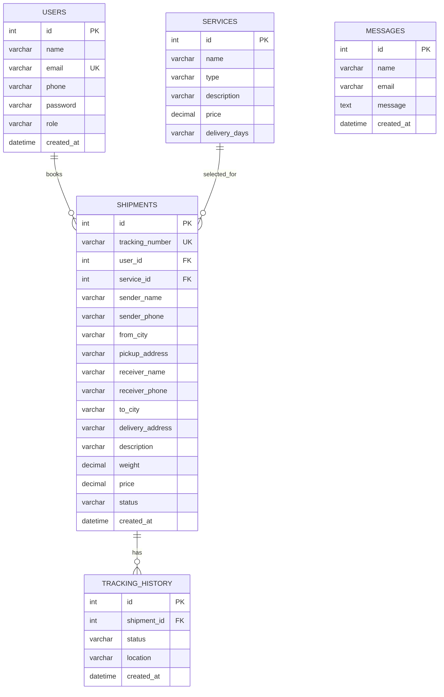
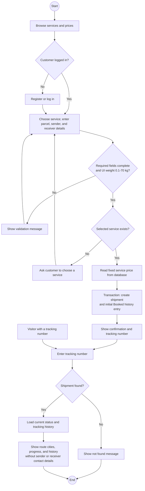

# Green Express Design Package

This package documents the current Green Express courier application and the design deliverables requested for the project. It is based on the React, Express, and MySQL source in this repository.

## Project scope

Green Express lets visitors browse courier services and prices, track a parcel with a tracking number, and send a contact message. Registered customers can book shipments, view their own shipments, and cancel a shipment while its status is still Booked. Administrators can review shipments and contact messages and add shipment status updates.

The supplied services are Domestic (NPR 150, 2-4 working days) and International (NPR 2,500, 7-12 working days). The current system uses one fixed price per selected service; the price is not calculated from parcel weight. The booking form presents a 0.1 to 70 kg range.

## 1. Full-stack architecture

```mermaid
flowchart LR
    visitor["Visitor / Customer / Admin"] --> browser["Web browser"]
    browser --> spa["React + Vite single-page app"]
    spa --> pages["Pages and shared UI<br/>Home, Track, Prices, Contact<br/>Login, Register, Book, My Shipments, Admin"]
    pages --> apiClient["Axios API client<br/>attaches JWT when present"]
    apiClient -->|"HTTP JSON /api/*"| express["Express REST API<br/>Node.js"]
    express --> cors["CORS + JSON middleware"]
    cors --> auth["JWT verification<br/>admin role check"]
    auth --> handlers["Route handlers<br/>validation, pricing, shipment rules"]
    cors --> handlers
    handlers --> pool["MySQL connection pool<br/>parameterized SQL"]
    handlers -->|"transaction for booking / status change"| tx["MySQL transaction"]
    pool --> db[("green_express MySQL database")]
    tx --> db
    db --> tables["users, services, shipments,<br/>tracking_history, messages"]
    tables -->|"JSON response"| express
    express -->|"JSON response"| apiClient
    apiClient --> pages
```



**Access boundaries**

- Public routes: service list, parcel tracking, and contact form.
- Customer routes: register, log in, book a shipment, view own shipments, and cancel a shipment before pickup.
- Admin routes: list all shipments, update shipment status, and review contact messages.
- Passwords are stored as bcrypt hashes. Login returns a one-day JWT; the frontend saves the token and user summary in local storage.

**Main API operations**

| Purpose | Endpoint | Access |
|---|---|---|
| List services and prices | GET /api/services | Public |
| Look up a parcel and its history | GET /api/track/:trackingNumber | Public |
| Create customer account / log in | POST /api/register, POST /api/login | Public |
| Create a shipment | POST /api/shipments | Customer |
| List a customer's shipments | GET /api/my-shipments | Customer |
| Cancel a booked shipment | PUT /api/shipments/:id/cancel | Customer |
| List all shipments / update status | GET /api/admin/shipments, PUT /api/admin/shipments/:id/status | Admin |
| Submit / review contact messages | POST /api/contact, GET /api/admin/messages | Public / Admin |

## 2. Database ER diagram



**Relationship and validation notes**

- A user can book many shipments; each shipment belongs to one user.
- A service can be selected by many shipments; each shipment stores one service and a copy of its price.
- A shipment can have many tracking history entries. Deleting a shipment cascades to its history; users and services referenced by shipments are restricted from deletion.
- Messages are independent contact form submissions and are not linked to a user account.
- User email and shipment tracking number are unique. Roles are customer or admin; service types are Domestic or International.
- Shipment statuses are Booked, Picked up, In transit, Out for delivery, Delivered, and Cancelled. Shipment weight must be greater than 0 and no more than 70 kg.

## 3. Core booking and tracking flowchart



**Other implemented paths:** customers can cancel only while a shipment is Booked; an admin status update changes the current shipment status and adds a tracking history row in one transaction.

## 4. Wireframes

### Home and tracking entry

```text
+----------------------------------------------------------------------------------+
| [G] Green Express     Home   Track   Prices   Contact       Log in   [Register]  |
+----------------------------------------------------------------------------------+
| From New York to London to Tokyo.                                                |
| Door-to-door courier for parcels and documents. Book online and follow each step.|
|                                                                                  |
+----------------------------------------------------------------------------------+
| TRACK A PARCEL                                                                  |
| [ Enter tracking number                                      ] [ Track ]        |
+----------------------------------------------------------------------------------+
| Our services                                                                    |
| [ Domestic / NPR 150 ]            [ International / NPR 2,500 ]                 |
| [ 2-4 working days ]              [ 7-12 working days ]                         |
+----------------------------------------------------------------------------------+
| How it works:  1. Book online  ->  2. We pick it up  ->  3. Track it            |
+----------------------------------------------------------------------------------+
| Green Express                                      Track a parcel | Prices      |
+----------------------------------------------------------------------------------+
```

### Book a shipment

```text
+----------------------------------------------------------------------------------+
| [G] Green Express     Home   Track   Prices   Contact       My shipments   Log out|
+----------------------------------------------------------------------------------+
| Book a shipment                                                                  |
| Enter parcel details, then confirm pickup and delivery addresses.                |
|                                                                                  |
| +--------------------------+ +--------------------------+ +--------------------+ |
| | PARCEL                   | | SENDER (PICKUP)           | | RECEIVER (DELIVERY)| |
| | Service        [select]  | | Name           [input]    | | Name      [input]  | |
| | Weight (kg)    [input]   | | Phone          [input]    | | Phone     [input] | |
| | What is inside [input]   | | City           [input]    | | City      [input] | |
| | Fixed price: NPR 150     | | Pickup address [input]   | | Address   [input] | |
| +--------------------------+ +--------------------------+ +--------------------+ |
|                                                                                  |
| [ Book shipment ]   Price is confirmed by the server; pay the courier at pickup. |
+----------------------------------------------------------------------------------+
```

### Tracking result

```text
+----------------------------------------------------------------------------------+
| Track a parcel                                                                   |
| [ GE12345678                                              ] [ Track ]             |
|                                                                                  |
| GE12345678                                     [ In transit ]                    |
| Kathmandu -> Pokhara | Domestic | Booked on 24 Nov 2026                         |
| Booked  ----  Picked up  ----  In transit  ----  Out for delivery  ---- Delivered|
|                                                                                  |
| Tracking history                                                                 |
| Date and time             Status                     Location                    |
| 24 Nov 2026, 09:10        In transit                 Kathmandu Hub               |
| 23 Nov 2026, 15:20        Picked up                  Kathmandu                   |
+----------------------------------------------------------------------------------+
```

## 5. Mockup

The visual mockup follows the existing frontend brand: navy navigation and actions, amber accent, white content areas, and muted gray supporting text. It presents the current three-part booking form and fixed price preview. Open [mockup-book-shipment.html](mockup-book-shipment.html) in a browser to view it.

## 6. RACI matrix

R = Responsible (does the work); A = Accountable (owns the result); C = Consulted; I = Informed. There is one accountable role per row. These are role placeholders because team member names were not provided; replace them with the assigned students.

| Work item | Project Lead | UI/UX | Frontend | Backend | Database | QA / Tester |
|---|---:|---:|---:|---:|---:|---:|
| Scope and requirements | A/R | C | C | C | C | C |
| Full-stack architecture | A | C | R | R | C | C |
| Database ER diagram | A | I | C | C | R | C |
| Wireframes and mockup | A | R | C | I | I | C |
| Frontend pages and routing | A | C | R | C | I | C |
| Backend API and access rules | A | I | C | R | C | C |
| Database schema and setup | A | I | I | C | R | C |
| Integration and acceptance checks | A | C | C | C | C | R |
| Documentation and presentation | A/R | C | C | C | C | C |

## Design assumptions

- The diagrams describe the current implementation, not a proposed replacement architecture.
- The wireframes summarize the implemented Home, Book Shipment, and Track pages; field names and navigation follow the app.
- The mockup is a static design preview. The working form remains in the React application.
- Assign student names to RACI roles before submitting the team responsibility matrix.

